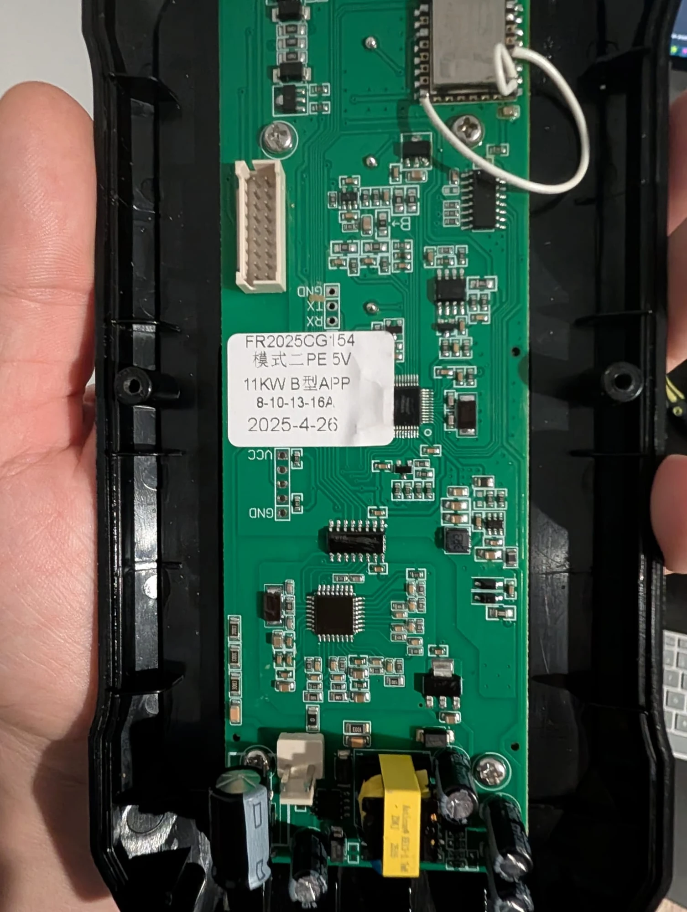
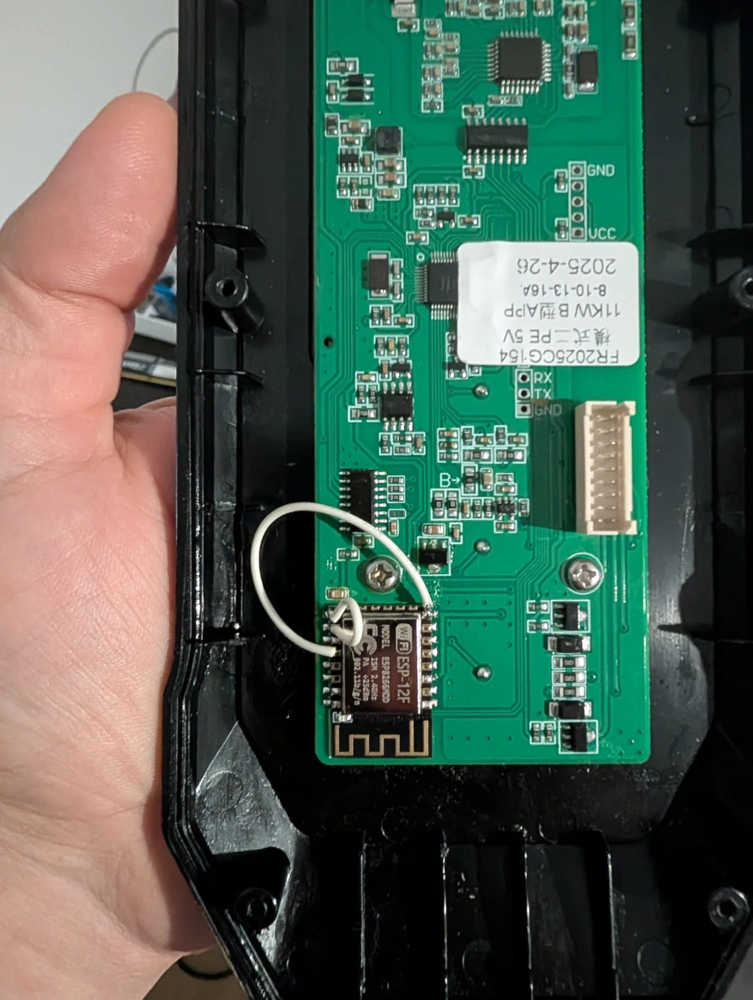
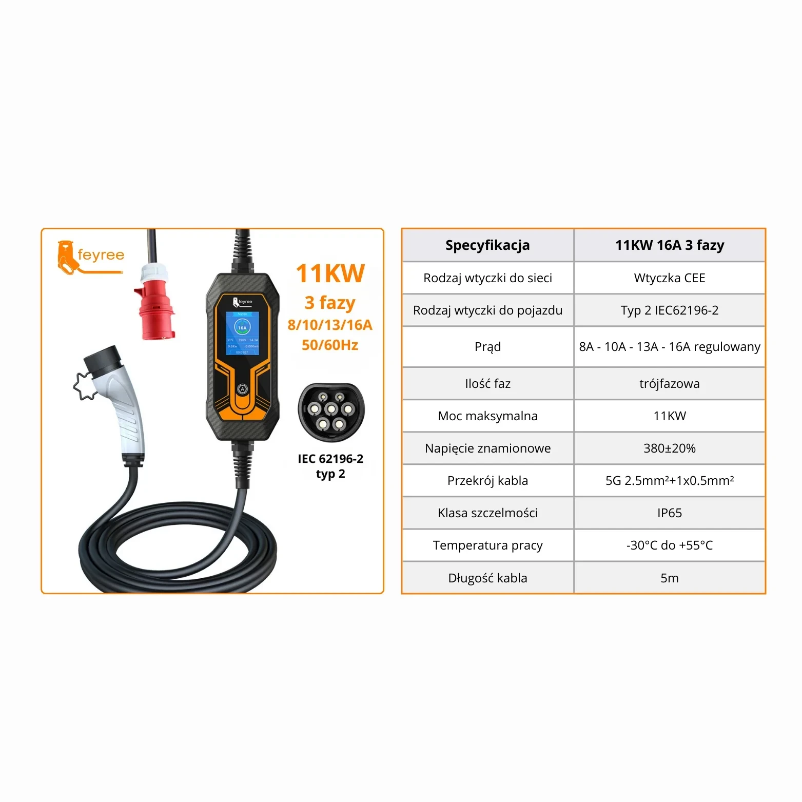

# ESPHome – Feyree EV 11 kW (3-fazowa, CEE 16A, Typ 2)

Konfiguracja ESPHome dla przenośnej ładowarki Feyree 11 kW z MCU Tuya, z modułem ESP-12F zamiast oryginalnego modułu WiFi.

- [feyree-ev-11kw.yaml](feyree-ev-11kw.yaml) – konfiguracja urządzenia (mapa DP, okablowanie w komentarzach)
- [ev-dashboard.yaml](ev-dashboard.yaml), [ev-dashboard-hacs.yaml](ev-dashboard-hacs.yaml) – dashboardy Home Assistant
- `secrets.yaml` nie jest w repo – utwórz własny z kluczami: `wifi_ssid`, `wifi_password`, `encryption_key`, `ota_password`

Web serwer: użytkownik `admin`, hasło `admin` – zmień przed użyciem.

## Zdjęcia

Płytka (FR2025CG154, 11KW B型APP, 8-10-13-16A):

ESP-12F na płytce:

Specyfikacja:

